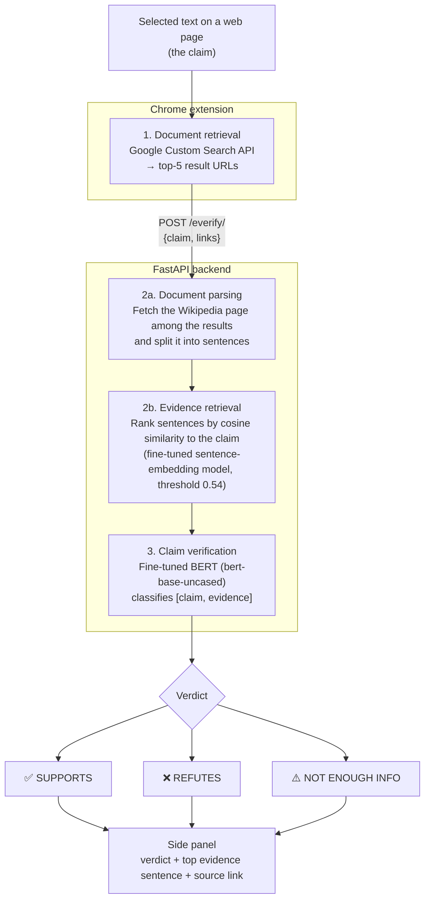

# VeriScan

**A Chrome extension for one-click fact-checking of any sentence on the web.**

Highlight a claim on any web page, right-click, and choose **VeriScan**. The extension retrieves evidence from the web, finds the most relevant sentences, and classifies the claim as **Supported**, **Refuted**, or **Not Enough Info**. The verdict and the evidence sentence are shown in Chrome's side panel, with a link to the source.

> Developed as an undergraduate capstone project at National Central University, Taiwan (2023–2024).

## Demo

[](https://youtu.be/hx9WleYAAko)

▶️ **[Watch the demo on YouTube](https://youtu.be/hx9WleYAAko)**

<p align="center">
  
</p>

---

## How it works

VeriScan follows the standard three-stage fact-verification pipeline: document retrieval, evidence sentence retrieval, and claim verification.



## Features

- **Context-menu integration:** fact-check any selected text without leaving the page.
- **Side-panel results:** the verdict, the top evidence sentence, and a link to the source page.
- **Neural evidence ranking:** a sentence-embedding model fine-tuned with contrastive learning ranks candidate evidence sentences.
- **Three-way verification:** a fine-tuned BERT classifier with FEVER-style labels (Supports / Refutes / Not Enough Info).
- **Decoupled architecture:** a lightweight Manifest V3 front end talks to a GPU-backed FastAPI inference server.

## Repository structure

```
VeriScan/
├── api/                          # Inference backend (FastAPI)
│   ├── everify.py                # API entry point: POST /everify/
│   └── method/
│       ├── splitDoc.py           # Fetch and parse Wikipedia pages into sentences
│       ├── bge_embedding.py      # Embedding-based evidence sentence retrieval
│       └── claimVeri.py          # BERT claim-verification classifier
└── front-end/                    # Chrome extension (Manifest V3)
    ├── manifest.json
    ├── background.js             # Context menu, Google search, API calls
    ├── result.html / result.js   # Side-panel UI
    ├── result.css
    └── *.png / loading.gif       # Icons and result images
```

## Getting started

> **Note:** The fine-tuned model weights are not publicly released, so the full system cannot be run from this repository alone. See the [demo video](https://youtu.be/hx9WleYAAko) to watch the system in action.

### Prerequisites

- Python 3.9+
- A CUDA-capable GPU (the verifier is loaded on `cuda`)
- Google Chrome (version 114 or later, for the Side Panel API)
- A Google Custom Search JSON API key and Programmable Search Engine ID

### 1. Install backend dependencies

```bash
pip install fastapi uvicorn pydantic torch transformers sentence-transformers \
            requests beautifulsoup4 tqdm
```

### 2. Add the model checkpoints

The fine-tuned model weights are **not included** in this repository. Place them as follows:

| Checkpoint | Location | Used by |
|---|---|---|
| `GFS35_FT_e3_b32.ckpt` (fine-tuned `bert-base-uncased`, 3 labels) | `api/` | `claimVeri.py` |
| `contrastive_ckpt_g16/` (Sentence-Transformers model directory) | `api/method/` | `bge_embedding.py` |

### 3. Start the API server

Run the server from the `api/` directory, because the checkpoint paths are relative to it:

```bash
cd api
uvicorn everify:app --host 127.0.0.1 --port 8000
```

Check that it is running: `GET http://127.0.0.1:8000/` should return `{"everify": "running"}`.

### 4. Load the Chrome extension

1. In `front-end/background.js`, set your own `apiKey` and `searchEngineID` for the Google Custom Search JSON API.
2. Open `chrome://extensions`, enable **Developer mode**, and click **Load unpacked**.
3. Select the `front-end/` folder.

## Usage

1. Highlight a sentence on any web page.
2. Right-click and select **VeriScan**.
3. The side panel opens and shows a loading animation, then the verdict:
   - ✅ *This sentence is supported.*
   - ❌ *This sentence is refuted.*
   - ⚠️ *This sentence lacks enough information.*
4. Click **Details** to see the evidence sentence and open its source page.

## API reference

### `POST /everify/`

**Request**

```json
{
  "claim": "Qatar is a language.",
  "links": [
    "https://en.wikipedia.org/wiki/Qatar",
    "https://www.familysearch.org/en/wiki/Qatar_Languages"
  ]
}
```

**Response**

```json
{
  "claim": "Qatar is a language.",
  "evidence": "Qatar, officially the State of Qatar, is a country in West Asia",
  "label": "REFUTES",
  "link": "https://en.wikipedia.org/wiki/Qatar"
}
```

`label` is one of `SUPPORTS`, `REFUTES`, or `NOT ENOUGH INFO`.

## Limitations

- **Wikipedia only for evidence.** Evidence is extracted only from the first Wikipedia page among the search results. If no Wikipedia page is returned, the claim is classified without evidence.
- **English only.** Both models are English models.
- **Checkpoints not public.** You need the fine-tuned weights to reproduce the results.
- **Inference requires a GPU** as currently configured.
- An earlier Wikipedia-search mode (`wverify` in `background.js`) depends on a query-rewriting endpoint that is not part of this repository and is disabled.

## Tech stack

- **Front end:** JavaScript, Chrome Extension Manifest V3 (Context Menus, Side Panel, BroadcastChannel)
- **Back end:** Python, FastAPI
- **Models:** PyTorch, Hugging Face Transformers (BERT), Sentence-Transformers
- **Retrieval:** Google Custom Search JSON API, BeautifulSoup
